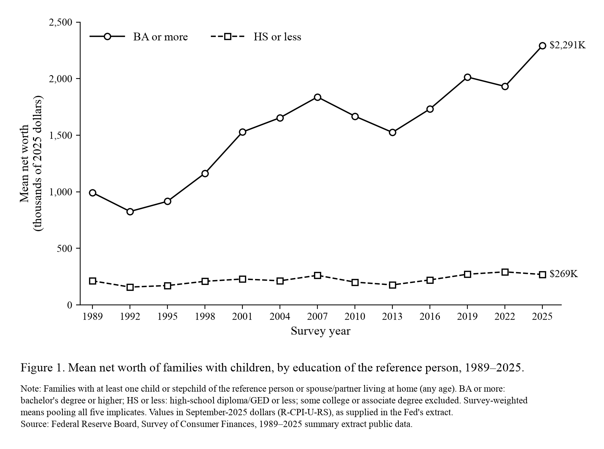
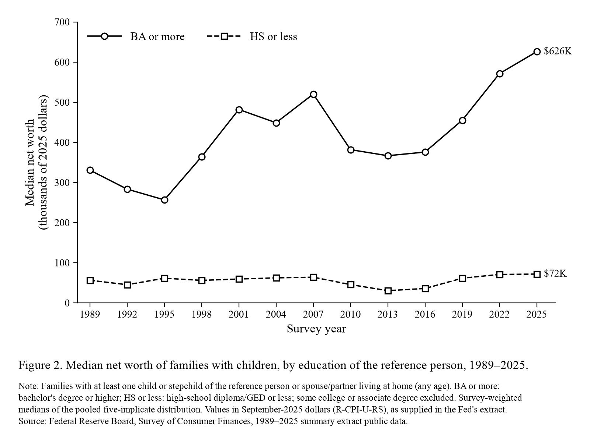

# Wealth of families with children, by education, 1989–2025

POLISCI 158, Section Assignment 3, **Option B**. This repository reproduces the
workshop's demonstration figure, the
[mean net worth of families with children by education](https://polisci158-2026.github.io/section-03/fig2-extended.png)
from the [Section 3 lab](https://polisci158-2026.github.io/section-03/index.html#lab).
It uses the original Federal Reserve data, downloaded by a script.

**Comparison.** The figure compares the net worth of two groups of US families with a child
living at home: those whose reference person has a bachelor's degree or more, and those
whose reference person has a high-school education or less. It covers every Survey of
Consumer Finances (SCF) wave from 1989 to 2025, which is the latest survey (results
released 9 October 2026).

**Source.** Federal Reserve Board, Survey of Consumer Finances,
[Summary Extract Public Data](https://www.federalreserve.gov/econres/scfindex.htm)
(CSV files `scfp1989excel.zip` … `scfp2025excel.zip`). The data cover 13 surveys: 1989,
1992, 1995, … 2022 and 2025. The Fed has already converted every wave to
**September-2025 dollars** with the R-CPI-U-RS, so the code makes no further inflation
adjustment.

## Definitions

- **Families.** An SCF family is the economically dominant person or couple in a
  household, plus the household members who are financially interdependent with them. The figure
  includes families with `KIDS > 0`: at least one child or stepchild of the reference
  person or their spouse/partner living at home. There is no age limit, so adult children
  at home count.
- **Education groups.** Education is that of the SCF *reference person*: the single adult,
  or in a couple the man (mixed-sex couples) or the older partner (same-sex couples). It is
  one person's education, not both parents', and it is not the respondent's own parents'.
  "BA or more" is `EDCL = 4`, and "HS or less" is `EDCL = 1, 2` (no diploma, or a
  high-school diploma or GED). Families whose reference person has some college or an
  associate degree (`EDCL = 3`) are left out.
- **Weights and imputations.** Every family appears five times in the data, once for each
  of five versions of its imputed answers. Means and medians use the survey weight `WGT`,
  which the Fed has already divided by five, and pool all five records. This is the Fed's
  own method, and it reproduces the Fed's published tables exactly. Medians are the first
  value at which the cumulative weight reaches half the total. Zero and negative net worth
  are kept.

## Figures





The plotted numbers are in `data/processed/networth_by_education.csv`, which also gives the
number of families behind each point (for example, 847 BA-or-more and 596 HS-or-less
families in 2025). The dollar gap and ratio for each year are in
`data/processed/gap_and_ratio.csv`.

## What the figure shows

- **1989.** Families with children whose reference person had a BA or more had mean net
  worth of $992,000. Families in the HS-or-less group had $213,000. That is a gap of
  $780,000, and a ratio of 4.7 to 1.
- **2025.** The two means were $2.29 million and $269,000. The dollar gap had grown to
  $2.02 million (95% interval $1.79–2.25 million), and the ratio had risen to 8.5 to 1
  (interval 6.6–10.4).
- **2013 versus 2025.** The ratio was about the same in both years (8.6 and 8.5), after
  dipping to 6.6 in 2022. The dollar gap, however, was $674,000 larger in 2025.
- **Caution.** These are descriptive comparisons. They do not show that education *causes*
  higher wealth, because age, inheritances, income, marriage and many other differences
  between the groups are not held constant.

## Extension: the median (Figure 2)

Figure 2 keeps the same data, families, groups and dollars, and replaces the mean with the
survey-weighted median. The medians are much lower: in 2025, $626,000 for BA-or-more
families and $72,000 for HS-or-less families. The mean is about 3.7 times the median in
both groups because a small number of very wealthy families pull the mean up, and the
median dollar gap ($554,000) is about a quarter of the mean gap. The two ratios are similar in
2025 (8.7 for the median and 8.5 for the mean), but the median ratio moved more over time.
It peaked at 12.0 in 2013, when the typical HS-or-less family held $30,500, and was
between 7.4 and 8.7 from 2019 to 2025.

## How to rerun

These commands were tested on macOS with Python 3.11 in a fresh copy of the repository.
Run them from the repository folder.

```bash
python3 -m venv .venv
.venv/bin/python -m pip install -r requirements.txt
.venv/bin/python get_data.py     # downloads 19 files (~69 MB) into data/raw/
.venv/bin/python plot.py         # writes figure.png, figure_median.png, data/processed/
.venv/bin/python validate.py     # optional: the checks summarized below
```

`get_data.py` finds the file links on the Fed's own pages. It refuses HTML error pages,
checks every archive, and records each file's URL, retrieval time and SHA-256 hash in
`data/raw/manifest.csv`. Rerunning it keeps files that are already valid. The raw downloads
are not committed, because the script retrieves them again. On Windows, use
`.venv\Scripts\python` instead of `.venv/bin/python` (not tested).

## Checks

The details are in [validation.md](validation.md).

- **The Fed's own tables.** The code reproduces all 182 cells of the Fed's public-data
  Table 4 (net worth by education and by family type, means and medians, 1989–2025). The
  largest difference is $5, which is rounding. This check covers all families and each
  education group, but not the exact families-with-children-by-education combination,
  which the Fed does not publish.
- **Margin of error.** The 2025 intervals follow the SCF's official method (999 replicate
  weights plus the variation across the five imputations). The same code gives standard
  errors close to the Fed's published ones.
- **Rerun from scratch.** A clean copy with a new environment re-downloaded every file and
  recreated identical data, numbers and figures.
- **The original figure.** It matches our results in coverage, groups and pattern. Its
  printed 2025 labels ($2,291K and $269K for the mean, $626K and $72K for the median) agree
  with our independently computed values. The labels were used only as a check, never as
  data.
- **Another source.** The Census Bureau's SIPP (an independent survey) also finds that the
  median wealth of college-educated households is about five times that of high-school
  households, though its definitions and levels differ.
- **Definitions.** The workshop calls the measure "parents' education". It is actually the
  education of one person, the SCF reference person.

## Files

| File | Purpose |
|---|---|
| `get_data.py` | Downloads the original SCF files from federalreserve.gov |
| `plot.py` | Computes the estimates and draws both figures |
| `validate.py` | Runs the checks behind `validation.md` |
| `figure.png`, `figure_median.png` | Figure 1 (reproduction) and Figure 2 (extension) |
| `data/processed/` | The plotted series, gap and ratio, and the validation tables |
| `data/raw/manifest.csv` | Source URLs, retrieval times and hashes of the downloads |

## AI-use note

ChatGPT helped prepare the task prompt for this assignment. Claude Code (Anthropic's Claude
Opus 5.5) did the work described here: it found the Federal Reserve files, wrote and ran
`get_data.py`, `plot.py` and `validate.py`, inspected and revised the figures, ran the
checks, and wrote this README and `validation.md`.
